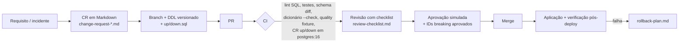

# Controle de mudanças de modelo de dados — RetentIQ

> **Simulação de processo corporativo / laboratório de portfólio.** Descreve o fluxo
> que este repositório implementa com Git, PR e CI. Não houve comitê, CAB ou
> homologação em empresa real.

## Fluxo

## Gates automatizados (CI — `.github/workflows/ci.yml`)

| Gate | O que barra |
|---|---|
| `pytest data-platform/tests` | ETL, regras de qualidade, dicionário, engenharia reversa, privacidade |
| ETL fixture + `quality/checks.py` | regra crítica de qualidade falhando (antes o job **pulava** os checks) |
| `export_dictionary.py --check` | coluna física sem metadado; dicionário desatualizado |
| `schema_diff.py` (SQLite e PostgreSQL) | drift incompatível não aprovado |
| `sqlfluff lint` (DDL/DML/migrações, dialeto postgres) | erro de sintaxe/estilo SQL |
| CR-001 up → up → down em `postgres:16` | migração não idempotente ou rollback que não restaura o modelo |

## Tipos de mudança

| Tipo | Exemplo | Exige |
|---|---|---|
| Aditiva compatível | coluna anulável, índice, view nova | PR + CI verde |
| Restritiva | novo CHECK/FK/NOT NULL | CR + validação sobre dado real + plano de rollback |
| Incompatível | remover/renomear coluna, mudar tipo | CR + **expand/contract** (adicionar novo, migrar consumidores, remover antigo em versão posterior) + ID aprovado no diff |

Exemplo completo: [change-request-example.md](change-request-example.md) (CR-001).
