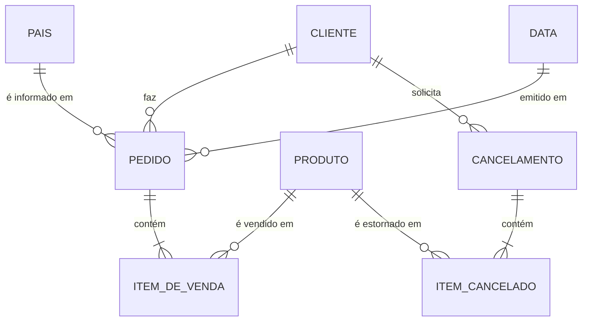

# Modelo conceitual — RetentIQ

> Nível conceitual: **o que o negócio enxerga**, sem tipos, chaves físicas ou SGBD.
> Diagrama versionado: [`diagrams/retentiq-conceptual.mmd`](diagrams/retentiq-conceptual.mmd)
> (Mermaid — renderiza direto no GitHub).

## Contexto

Um varejista online do Reino Unido vende artigos de presente para clientes de 40
países (+ o valor `Unspecified`; dado real: 2009-12-01 a 2011-12-09). O RetentIQ quer responder: **quem
compra, quanto, com que frequência e quem está deixando de comprar** (retenção).

## Entidades e o que de fato existe no dataset

| Entidade | Definição (ver [glossário](business-glossary.md)) | Representada na origem? | Onde fica no modelo analítico |
|---|---|---|---|
| Cliente | comprador identificado | **Parcial**: só um `Customer ID`; sem nome, e-mail, endereço. 22,8% das linhas não têm cliente | `dim_customer` |
| Produto | item de catálogo | Sim (`StockCode`, `Description`) — inclui códigos de serviço como `POST` e `M` | `dim_product` |
| País | país informado na nota | Sim, como texto livre por **linha** | `dim_country` |
| Data | dia/instante da nota | Sim (`InvoiceDate`, sem fuso) | `dim_date` + `invoice_date` |
| Pedido | uma nota (`Invoice`) | **Implícito**: não há tabela de pedidos, só o número repetido nas linhas | dimensão degenerada `fact_sales.invoice` |
| Item de venda | linha da nota | Sim — é a granularidade da origem | `fact_sales` (grão) |
| Cancelamento | nota com prefixo `C` | Sim (regra da própria origem) | `fact_sales_cancelled` |
| Item cancelado | linha da nota `C` | Sim | `fact_sales_cancelled` (grão) |

**Não inventado de propósito:** não há entidade "Endereço", "Loja", "Promoção",
"Pagamento" nem "Assinatura" — o dataset não as contém. (O módulo
`data-platform/revenue/` usa um painel de assinaturas **sintético**, separado
deste modelo.)

## Cardinalidades

| Relação | Cardinalidade | Observação baseada no dado real |
|---|---|---|
| Cliente — Pedido | 1 : 0..N | um cliente aparece em vários pedidos |
| Pedido — Item | 1 : 1..N | um pedido tem pelo menos uma linha; **o mesmo produto pode aparecer em mais de uma linha do mesmo pedido** (23.756 grupos invoice+produto+preço repetidos) |
| Produto — Item | 1 : 0..N | — |
| País — Pedido | 1 : 0..N | na origem o país é por **linha**; 13 clientes compram de mais de um país |
| Cancelamento — Venda original | **não representada** | a nota `C` não referencia a nota original; não dá para casar estorno com venda item a item |

## OLTP de origem inferido × modelo analítico adotado

| Aspecto | OLTP inferido (provável sistema do varejista) | Modelo adotado (OLAP, esquema estrela) |
|---|---|---|
| Objetivo | registrar transações | analisar receita, frequência e recência |
| Pedido | tabela `pedido` com cabeçalho (cliente, país, data) + `item_pedido` | cabeçalho **desnormalizado** em cada linha do fato |
| Cliente | cadastro com dados pessoais | só o pseudônimo `customer_id` (minimização) |
| Cancelamento | provavelmente status/vínculo com o pedido original | fato separado, sem vínculo (a origem não traz) |
| Histórico | atualização no lugar | full refresh a cada carga (sem SCD — ver [modelo lógico](logical-model.md)) |

A origem que recebemos já é uma **extração plana** (uma planilha), não o OLTP. O
OLTP acima é inferência documentada, usada só para discutir normalização em
[normalization-analysis.md](normalization-analysis.md).
