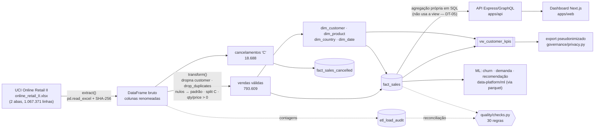

# Linhagem de dados — RetentIQ

> Linhagem documentada a partir do código real (`extract_transform_load.py`,
> `schema_sqlite.sql`, `apps/api/src/services/metricsService.ts`). Não há
> ferramenta de linhagem automática (ex.: OpenLineage) neste projeto — isto é
> linhagem **manual versionada**, verificada pelos testes de reconciliação.

## Fluxo ponta a ponta

## Etapas

| # | Etapa | Código | Entrada → saída | Controle |
|---|---|---|---|---|
| 1 | Leitura | `extract()` | `.xlsx` → DataFrame (9 colunas) | SHA-256 do arquivo em `etl_load_audit.source_sha256` |
| 2 | Padronização | `transform_with_stats()` | `invoice`/`stock_code` → texto; `customer_id` → int; nulos → `DESCONHECIDO`/`Unspecified` | contagens de descarte gravadas |
| 3 | Deduplicação | `drop_duplicates()` | remove linhas 100% iguais (11.996 reais) | `dropped_duplicates` |
| 4 | Separação | prefixo `C` | vendas × cancelamentos | CHECK de prefixo + regra `cancelamento.ausente_em_fact_sales` |
| 5 | Validação de venda | `price > 0 and quantity > 0` | remove 71 vendas reais | `dropped_invalid_sales` |
| 6 | Dimensões | `drop_duplicates(keep="last")` | 5.878 clientes, 4.631 produtos, 41 países, 604 dias | PK + `pk.*_unico` |
| 7 | Fatos | `merge` + chaves | `fact_sales`, `fact_sales_cancelled` | FK + `PRAGMA foreign_key_check` |
| 8 | Carga | `load()` | SQLite com DDL explícito | contagem pós-insert = DataFrame |
| 9 | Consumo | `vw_customer_kpis` | KPIs por cliente | `view.vw_customer_kpis_sem_double_counting` |
| 10 | Validação | `run_quality_checks()` | relatório JSON + exit code | 30 regras ([quality-rules.yaml](quality-rules.yaml)) |

## Linhagem por coluna — 5 indicadores críticos

| Indicador | Coluna final | Origem | Transformações (em ordem) |
|---|---|---|---|
| **Receita bruta** | `fact_sales.revenue` → `SUM` / `vw_customer_kpis.total_revenue` | `Quantity`, `Price` | descarta sem cliente → descarta duplicata exata → descarta nota `C` → descarta `qty<=0`/`price<=0` → `quantity * price` → `SUM` |
| **Venda líquida** | (calculada) `SUM(fact_sales.revenue) + SUM(fact_sales_cancelled.revenue)` | `Quantity`, `Price`, `Invoice` | igual à receita bruta para vendas; cancelamentos: sem cliente descartado → duplicata descartada → `quantity * price` (negativo). Dado real: 17.685.460,64 − 1.092.067,63 = **£ 16.593.393,01** |
| **Pedidos por cliente** | `vw_customer_kpis.total_orders` | `Invoice`, `Customer ID` | mesmos filtros da receita → `COUNT(DISTINCT invoice)` por cliente |
| **Recência (última compra)** | `vw_customer_kpis.last_purchase` | `InvoiceDate`, `Customer ID` | mesmos filtros → `MAX(invoice_date)` por cliente (base do churn em `ml/churn_model.py`) |
| **Taxa de cancelamento por mês** | `COUNT(fact_sales_cancelled) / COUNT(fact_sales)` por `date_id/100` | `Invoice`, `InvoiceDate` | prefixo `C` → `date_id = AAAAMMDD(invoice_date)` → agrupamento por AAAAMM (consulta `q4` em `warehouse/performance/queries.sql`) |

## O que a linhagem NÃO cobre

- Transformações dentro da API e do dashboard (agregações em TypeScript) não estão
  mapeadas coluna a coluna.
- Os modelos de ML leem `datasets/processed/*.parquet`, não o SQLite: a linhagem
  `fact_sales → parquet` é 1:1 (mesmo DataFrame), mas não é verificada por teste.
